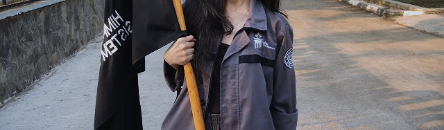

  

 

## Hi there 👋, I'm Evelyn Anastasia!

**Telecommunication Systems Engineer in the making, building intelligent systems from physical sensors to scalable cloud architectures.**

- 🔭 **Currently building:** End-to-end synthetic monitoring infrastructure & alerting systems at **Diskominfo Jawa Barat** (APTIKA).
- 🚀 **Past impact:** Engineered ML-driven content opportunity scoring pipelines at **FlyRank AI** (Chicago, USA) and analyzed 20kV power grid reliability & SCADA telemetry at **PT PLN (Persero) UP3 Bandung**.
- 🌱 **Currently exploring:** Production AI, Agentic RAG workflows, and high-availability backend systems.
- 🤝 **Open to collaborate on:** Backend engineering, IoT telemetry, AI/ML modeling, and network automation projects.
- 📫 **Reach me out:**

  
  
  

---

<h3 align="center">🤎 Tech Stack</h3>

  

  <code>ESP32</code> · <code>SCADA</code> · <code>Cisco Packet Tracer</code> · <code>Playwright</code> · <code>Puppeteer</code> · <code>Looker Studio</code> · <code>Pandas</code> · <code>Google Colab</code>

---

<h3 align="center">📊 GitHub Stats</h3>

  
  

---

### 📌 Highlighted Engineering Works

- **📡 APTIKA Synthetic Monitoring System** — *Architected a dual-headless browser synthetic monitoring engine tracking uptime, latency, and automated alerts across dozens of regional government web services.* (`Node.js` · `Express` · `Prisma` · `PostgreSQL` · `Playwright`)
- **🧠 Content Opportunity Scoring Pipeline** — *Developed machine learning scoring workflows to evaluate content refresh priorities and organic search potential during a remote internship in Chicago.* (`Python` · `Pandas` · `Machine Learning`)
- **⚡ 20kV Feeder Outage & SCADA Analytics** — *Analyzed distribution grid reliability across 14 feeders and 3,500+ cable segments, translating raw telemetry into actionable executive dashboards.* (`SCADA` · `Looker Studio` · `Data Analytics`)
- **🌊 PureStream IoT** — *Built a real-time water quality telemetry system measuring pH, turbidity, and temperature with automated cloud threshold notifications.* (`ESP32` · `C++` · `Arduino` · `IoT`)
- **🫁 Chest X-Ray Pneumonia Classifier** — *Fine-tuned a ResNet-18 deep learning vision model to classify thoracic radiographs into normal and pneumonia categories with high diagnostic precision.* (`Python` · `PyTorch` · `ResNet-18`)

---

  <i>"Where physical signals meet intelligent software — engineering reliable systems, one packet at a time."</i>
    
  

